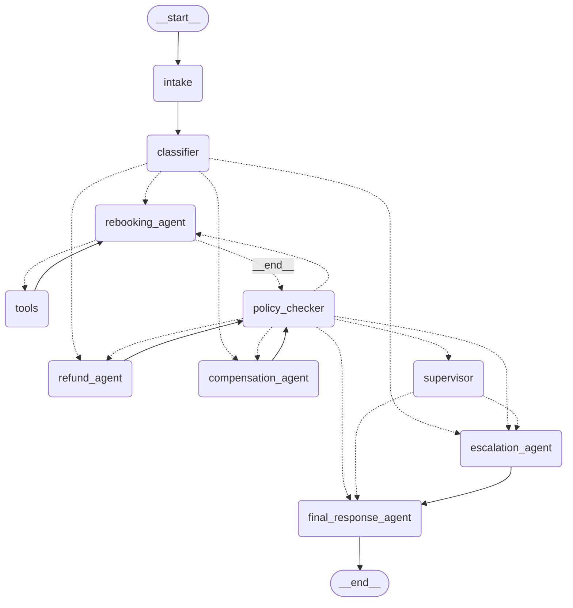

# Flight Disruption Rebooking Assistant

A LangGraph airline-disruption assistant: a passenger whose flight was cancelled or
delayed sends a message, and a graph of agents works out what they need, finds a
solution, checks it against airline policy, and replies — with a retry cycle,
human supervisor approval, and per-thread persistence.

## Quickstart

```bash
python -m venv .venv
.venv\Scripts\activate        # Windows (use `source .venv/bin/activate` on macOS/Linux)
pip install -r requirements.txt
copy .env.example .env        # then add your free GROQ_API_KEY from https://console.groq.com/keys
python run_scenarios.py       # runs all 4 scenarios + the follow-up, saves docs/graph.mermaid
```

One LLM API key (Groq, free tier) is required. No other external services — all
tools are mocks.

## Graph diagram

Generated by `run_scenarios.py` via `graph.get_graph().draw_mermaid()` → `docs/graph.mermaid`.



Dashed edges are conditional; `rebooking_agent ⇄ tools` is the tool-calling loop and
`policy_checker → agent` is the retry cycle.

## Node responsibilities

| Node | Type | Responsibility |
|---|---|---|
| `intake` | plain Python | Loads the booking once (`get_booking`), reuses it on follow-ups, resets per-turn fields (solution, policy result, retry count, escalation, approval) |
| `classifier` | LLM, structured output | Extracts `intent` (rebook/refund/compensation/complaint) and `constraints` (e.g. `latest_arrival`) from the conversation |
| `rebooking_agent` | LLM + tools | Binds `get_booking` and `search_flights`; loops with `ToolNode` until it proposes one new flight as JSON |
| `refund_agent` | LLM + tool data | Reads booking + `get_fare_rules`, proposes a refund amount |
| `compensation_agent` | LLM | Reads booking + delay length, proposes a compensation amount |
| `tools` | `ToolNode` | Executes mock tool calls made by the rebooking agent |
| `policy_checker` | plain Python (no LLM) | Validates the proposed solution against the airline rules below; increments `retry_count` on failure |
| `supervisor` | `interrupt()` | Human-in-the-loop approval for any refund/compensation over $300 (bonus) |
| `escalation_agent` | LLM | Writes a short handover note for a human agent |
| `final_response_agent` | LLM | Writes the passenger-facing reply (arrangement, next steps, follow-up) |

## State design (`rebook/state.py`)

`RebookingState` is a `TypedDict`. Each node updates only its own fields.

| Field | Written by | Notes |
|---|---|---|
| `request_id`, `booking_ref` | input | Caller-provided |
| `messages` | many nodes | **`add_messages` reducer** — full conversation history |
| `intent`, `constraints` | classifier | Structured classification |
| `booking` | intake | Loaded once, reused on follow-ups |
| `proposed_solution` | rebooking/refund/compensation agents | `{"type": ..., "amount": ..., "flight": ...}` |
| `fare_rules` | refund agent | Fare-rule lookup, visible in state |
| `policy_check` | policy_checker | `{"passed": bool, "reason": str}` |
| `retry_count` | policy_checker | Retry counter that guarantees termination |
| `escalated`, `escalation_note` | escalation agent | Escalation status + handover note |
| `approved` | supervisor | Supervisor decision |
| `final_response` | final response agent | Passenger-facing reply |

## Routing logic (all in conditional edges, `rebook/graph.py`)

1. **Intent router** (`route_intent`): rebook → rebooking, refund → refund,
   compensation → compensation, **complaint → escalation** (straight to a human).
2. **Tool loop** (`tools_condition`, prebuilt): `rebooking_agent` → `tools` while the
   LLM makes tool calls, otherwise → `policy_checker`.
3. **Policy router** (`route_policy`):
   - **pass** → `supervisor` if refund/compensation > $300, else → `final_response_agent`
   - **fail, `retry_count < 3`** → back to **the same agent that proposed the solution**,
     with the failure reason in `state.policy_check.reason` (the cycle)
   - **fail, `retry_count >= 3`** (first try + 2 retries) → `escalation_agent`
4. **Supervisor router** (`route_supervisor`): approved → final response, rejected → escalation.

Termination guarantee: `retry_count` only increments inside `policy_checker`, the
back-edge is only taken while `retry_count < 3`, and `recursion_limit: 50` bounds every run.

## Policy rules (`rebook/policy.py`, pure Python)

| Request | Rule |
|---|---|
| Rebook | Same cabin class or lower; departs within 48 hours; connection time ≥ 60 minutes |
| Refund | Airline cancelled: full fare. Passenger choice on a non-refundable fare: taxes only |
| Compensation | Delay under 3 h: $0. 3–6 h: $200. Over 6 h or cancelled: $400 |

Failing checks return a human-readable reason, e.g.
`proposed cabin 'business' is higher than booked cabin 'economy'; rule: same cabin class or lower`.

## Tools (`rebook/tools.py`) — all mocks, deterministic

| Tool | Used by | Returns |
|---|---|---|
| `get_booking(booking_ref)` | all agents | passenger, route, cabin, fare type/price, disruption details |
| `search_flights(origin, destination, date)` | rebooking agent | flights with times, cabins, stops, connection minutes |
| `get_fare_rules(fare_type)` | refund agent | refundable flag + tax amount |

Search results deliberately include policy-breaking options: a 45-minute connection,
a business-class-only flight, and a route (`LHR→HND`) where **every** option is
business-class-only — that is what drives the scenario-3 retry loop.

## Checkpointer

Compiled with **`SqliteSaver`** (`checkpoints.db`, git-ignored) — a `thread_id` per
passenger conversation keeps messages, booking, and classification across invocations.
A follow-up message on the same `thread_id` continues the conversation **without
re-asking for the booking reference**: `intake` finds the booking already in state and
skips the lookup. (This also covers the persistent-checkpointer bonus item.)

The supervisor approval uses `interrupt()` (human-in-the-loop bonus); the test runner
auto-approves so the single command still runs end-to-end.

## Test evidence

`python run_scenarios.py` output (paths shown exactly as printed by the graph):

### Scenario 1 — Cancelled flight, must arrive by noon
Input: *"My flight to Dubai was cancelled. I need to be there by tomorrow noon."*

```
Path: intake -> classifier -> rebooking_agent -> tools -> rebooking_agent -> policy_checker -> final_response_agent
```
> Your cancelled LHR->DXB flight has been rebooked on Emirates EK005 in economy.
> It departs London at 21:00 on 15 Oct and arrives in Dubai at 06:30 on 16 Oct,
> well before your noon deadline. ...

**Follow-up on the same `thread_id`** — *"Actually, can I get a refund instead?"*

```
[interrupt] supervisor approval required -> auto-approving
Path: intake -> classifier -> refund_agent -> policy_checker -> supervisor(interrupt) -> supervisor -> final_response_agent
```
> We've processed a full refund of $640 (including taxes) ...

The booking was reused from the checkpointer; no booking reference was re-sent.

### Scenario 2 — 6-hour delay, asks about compensation
Input: *"My flight is delayed 6 hours. Am I entitled to anything?"*

```
Path: intake -> classifier -> compensation_agent -> policy_checker -> final_response_agent
```
> ... your flight was delayed by 6 hours, which makes you eligible for a $200
> compensation under our policy. ...

### Scenario 3 — Only business-class seats available
Input: *"My flight to Tokyo was cancelled and every option you have is business class."*

```
Path: intake -> classifier -> rebooking_agent -> tools -> rebooking_agent -> policy_checker
      -> rebooking_agent -> tools -> rebooking_agent -> tools -> rebooking_agent -> tools
      -> rebooking_agent -> policy_checker -> rebooking_agent -> policy_checker
      -> escalation_agent -> final_response_agent
```
Policy check **failed 3 times** (first try + 2 retries), each failure reason fed back to
the rebooking agent, then escalation:

> ... only business-class options are showing up, which doesn't match your economy-class
> preference. ... we've escalated your case to a senior team member. ...

### Scenario 4 — Complaint asking for a manager
Input: *"This is the third time you've cancelled on me. I want to speak to a manager."*

```
Path: intake -> classifier -> escalation_agent -> final_response_agent
```
> ... I've flagged this for a manager and they'll reach out shortly ...

## Project layout

```
├── run_scenarios.py      # single command: 4 scenarios + follow-up + mermaid export
├── rebook/
│   ├── state.py          # RebookingState (TypedDict + add_messages reducer)
│   ├── data.py           # fixed mock bookings / flights / fare rules
│   ├── tools.py          # the three mock @tool functions
│   ├── policy.py         # pure-Python policy checks
│   ├── prompts.py        # all prompt text, separate from logic
│   ├── llm.py            # LLM factory (Groq via free tier)
│   ├── nodes.py          # the 10 node functions
│   └── graph.py          # StateGraph assembly, routers, SqliteSaver
├── docs/graph.mermaid    # exported diagram
├── requirements.txt
└── .env.example          # GROQ_API_KEY template (no keys in the repo)
```

## Design notes

- **Routing lives in conditional edges**, not inside nodes — each scenario's path is
  determined by `route_intent`, `route_policy`, `route_supervisor`, and `tools_condition`.
- **Failure feedback reaches the agent**: the rejection reason stored in
  `policy_check.reason` is injected into the proposing agent's system prompt on retry.
- **The policy checker never calls an LLM** — it is a plain Python function so rules
  are auditable and deterministic.
- **Prompts are isolated** in `prompts.py`; node code only assembles state into them.
- **Deterministic mock data**: a fixed clock (`2026-10-15 08:00`) makes the 48-hour
  rule stable across runs.
